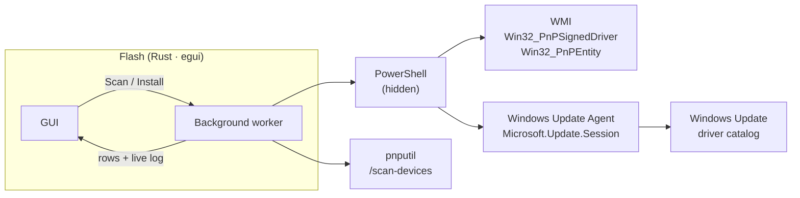

<div align="center">


# Flash

**Every device, every driver, up to date.**<br>
A Windows driver updater in Rust. It scans every device on the PC, shows the driver version each one runs, finds missing drivers and installs updates from Windows Update.

[](#install)
[](Cargo.toml)
[](src/main.rs)
[](src/lib.rs)
[](Cargo.toml)

[What it does](#what-it-does) ·
[How it works](#how-it-works) ·
[Install](#install) ·
[Build from source](#build-from-source) ·
[Safety](#safety)

</div>

---

## What it does

<table>
<tr>
<td width="50%" valign="top">

### Scan
Rescans hardware with `pnputil /scan-devices`, then lists every Plug and Play
device with a driver: its class, name, driver version and provider. The scan
starts as soon as the app opens.

</td>
<td width="50%" valign="top">

### Missing drivers
Flags devices that Device Manager would show with a yellow warning: no driver
installed (code 28), not configured (1), cannot start (10) or needing a
reinstall (18). They're listed in red with their hardware ID.

</td>
</tr>
<tr>
<td width="50%" valign="top">

### Updates
Asks Windows Update for every driver this PC is missing or has an older version
of. Each update is matched to its device by hardware ID, so you see
**current version → new** or **MISSING → install** next to it.

</td>
<td width="50%" valign="top">

### Install
One click downloads and installs the updates through the Windows Update Agent,
reports success or failure for each one, says when a reboot is needed, and then
rescans so the list shows the new versions.

</td>
</tr>
</table>

## How it works



Flash doesn't bundle drivers or call a third-party driver site. Every driver comes
from Microsoft's Windows Update catalog.

## Install

Build it (below), then run `target\release\flash.exe`.

| Step | What happens |
|---|---|
| Open `flash.exe` | Windows shows the **UAC prompt**, because the exe is built to require administrator |
| Click **Yes** | Flash opens and starts scanning right away |
| Wait about a minute | The Windows Update check finishes and the update list fills in |
| Click **Install N update(s)** | Drivers download and install, then Flash rescans |

Builds are unsigned, so Windows SmartScreen may warn on first run.

## Build from source

> [!NOTE]
> Needs Windows 10/11 x64, Rust stable (MSVC), and Visual Studio Build Tools with the Windows SDK (for `rc.exe`, which embeds the icon).

```powershell
cargo build --release   # target\release\flash.exe
cargo test              # runs unelevated
```

`cargo run` has to be started from an **administrator** terminal, because the exe asks Windows for elevation.

The app icon is drawn as SVG in [`assets/flash.svg`](assets/flash.svg) and
rendered to [`flash.png`](assets/flash.png) (window icon) and a multi-size [`flash.ico`](assets/flash.ico) (Explorer and taskbar).

## Safety

> [!IMPORTANT]
> Installing drivers changes your system. Flash only installs what Windows Update
> offers for your hardware, but a driver update can still change how a device behaves.
> Create a restore point first if the PC matters to you.

- **Install is all-or-nothing:** the Install button installs every listed update, and auto-accepts any license agreement a driver comes with.
- **Windows Update only:** a device whose maker doesn't publish drivers to Windows Update shows as missing, but Flash can't install anything for it.
- **Group Policy:** if Windows Update is set to exclude drivers (common on work PCs), no updates show up.

## Project layout

<details>
<summary><b>Files</b></summary>

| File | What it holds |
|---|---|
| [`src/main.rs`](src/main.rs) | The egui window: toolbar, update, missing-driver and device tables, live log |
| [`src/lib.rs`](src/lib.rs) | Scanning and install logic: PowerShell/WMI queries and the Windows Update Agent |
| [`build.rs`](build.rs) | Embeds the `requireAdministrator` manifest and the app icon |
| [`assets/`](assets) | App icon as SVG, PNG and ICO |

</details>

<div align="center">
<sub>Flash · Windows driver updater in Rust</sub>
</div>
