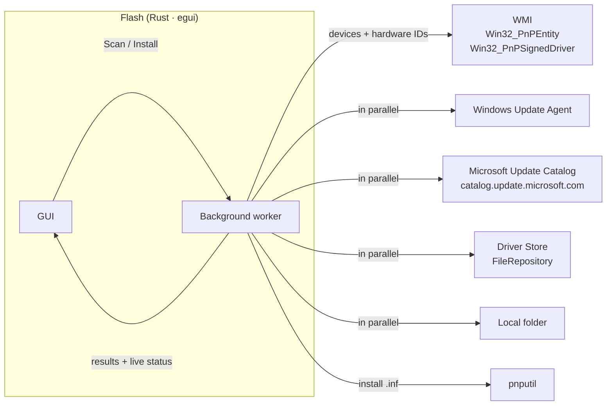

<div align="center">


# Flash

**Every device, every driver, up to date.**<br>
A driver updater and PC health tool for Windows and Linux in Rust: drivers from four sources, hardware health with a built-in hardware-error knowledge base, CPU/GPU/memory/disk benchmarks, storage cleanup and a live system monitor.

[](#install)
[](#flash-for-linux)
[](Cargo.toml)
[](src/main.rs)
[](#update-sources)
[](#system-tools)
[](https://github.com/ljcatherine/Flash/releases/latest)
[](LICENSE)

[**flash.liamjc.dev**](https://flash.liamjc.dev) ·
[**Download**](https://github.com/ljcatherine/Flash/releases/latest) ·
[What it does](#what-it-does) ·
[System tools](#system-tools) ·
[Update sources](#update-sources) ·
[How it works](#how-it-works) ·
[Install](#install) ·
[Linux](#flash-for-linux) ·
[Build from source](#build-from-source) ·
[Safety](#safety)

</div>

---

## What it does

Flash checks GitHub for new stable app releases at startup. Open **App updates**
in the sidebar to check again or see an available version. Flash verifies the
download against GitHub’s published SHA-256 digest before you choose to install.
The MSI build upgrades through Windows Installer. The portable build replaces its
executable in place. Open Flash again when the update finishes.

Closing Flash while it's scanning (or installing, benchmarking or cleaning) hides it
to the notification area instead of quitting. A Windows notification says so, with
**Stop scan** and **Quit Flash** buttons, and another tells you when the job is done.
Click the notification or the tray icon to bring Flash back.

**New in 1.1:** a weekly background scan that only notifies you when something needs
attention, a driver history with one-click undo, hiding updates you don't want, CPU/GPU
temperatures in the monitor, a stress test that watches for new hardware errors, turning
startup apps on or off (with how much each slowed boot), a BIOS age check with a link to your
board's BIOS page, the latest NVIDIA driver check, and a shareable HTML health report. Advice
is tuned per architecture: AMD Zen 1 to Zen 5, Intel 6th gen to Core Ultra, and NVIDIA, AMD
Radeon, Intel Arc and Intel integrated graphics each get their own knowledge base.

<table>
<tr>
<td width="50%" valign="top">

### Devices
Every device with a driver (or one that should have one), **grouped by purpose**:
Display, Audio, Network, Bluetooth, Storage, Input, USB, Cameras, Printers,
Security, Chipset and more. Each group shows its updates and problems, and the
table sorts and searches across them. Click a device for its driver details, INF file,
signer, hardware IDs and the updates found for it.

</td>
<td width="50%" valign="top">

### Updates
One list across all sources, showing the installed version, the available
version, release date and where it came from. Tick what you want, and Flash
installs each one through the right channel, then rescans.

</td>
</tr>
<tr>
<td width="50%" valign="top">

### Problems
Devices Device Manager flags with a warning (no driver, failed to start,
needs reinstalling, disabled...), each in plain words and with a suggested fix,
including whether Flash found a driver for it.

</td>
<td width="50%" valign="top">

### Safety tools
Creates a **restore point** before installing (on by default), **backs up**
every third-party driver to a folder with one click, and opens System Restore
or Device Manager when you need them.

</td>
</tr>
<tr>
<td colspan="2" valign="top">

### Health map
A mind map of the PC: **This PC** in the middle, a branch for each purpose,
colored by its worst status, and leaves for the devices that need attention
(installed → available version, or the problem). Click any branch or device to open it.

</td>
</tr>
</table>

## System tools

<table>
<tr>
<td width="50%" valign="top">

### Device health
A summary of the PC (CPU, memory, motherboard, BIOS, graphics), each drive's health
(status, temperature, life used, hours, read errors), battery wear, and the last 30 days
of hardware errors, blue screens and unexpected shutdowns. Every WHEA hardware error is
grouped and explained from a **built-in knowledge base**: what it means, likely causes and
fixes in order, tuned for AMD or Intel. It also spots memory running below its rated speed
(XMP/EXPO off) from the module part number.

</td>
<td width="50%" valign="top">

### Benchmarks
CPU on one core and all cores, memory bandwidth, **GPU shader compute and fill rate**,
and disk sequential write, read and random 4K reads on the drive you pick. GPU tests run
in OpenGL on the window's own context; disk tests bypass the Windows cache, so they
measure the drive, not RAM. Each result gets a plain rating and a bar against a fast current PC.

</td>
</tr>
<tr>
<td width="50%" valign="top">

### Storage & cleanup
Usage bars for every drive, a breakdown of what's on the system drive (Windows,
programs, your files, app data...), the largest files in your folders, and a cleaner
for temp files, caches, crash dumps, Windows Update leftovers, the Recycle Bin,
**old driver versions** and preinstalled apps you may not need.

</td>
<td width="50%" valign="top">

### System monitor
Press Start, then go work or game. Live CPU, memory, GPU, disk and network graphs
with session peaks, per-thread load, and a table of which apps use what (CPU, RAM,
**GPU** and disk), grouped by app. Also lists the programs that start with Windows.

</td>
</tr>
</table>

The cleaner measures everything first and only removes what you tick, after a confirmation. It
never follows links or junctions, refuses short paths like `C:\Windows`, skips files in use,
and `pnputil` won't delete a driver package a device still uses. Preinstalled apps and old
drivers are never ticked by default.

### Hardware error knowledge base

Every WHEA-Logger event names a component, an error source and (for CPUs) a machine-check
error type. [`src/whea.rs`](src/whea.rs) covers every value of those:

| Area | Covered |
|---|---|
| CPU machine checks | Cache hierarchy, TLB, bus/interconnect (Infinity Fabric on Ryzen), internal parity / unclassified / microcode / FRC, watchdog timer, external |
| Memory | Fatal (non-ECC) and corrected (ECC) memory errors |
| PCI Express | Root ports, endpoints, switch ports and bridges, corrected and fatal, with the device behind the port named |
| Other sources | Non-maskable interrupts, PCI bus, platform and generic errors |

Advice changes with context: AMD vs Intel fixes, memory running at stock speed (points at hardware
rather than settings), and repeats on a single CPU thread (points at one weaker core).

## Update sources

| Source | What it checks | Installs with |
|---|---|---|
| **Windows Update** | Drivers Microsoft offers this PC through Windows Update | Windows Update Agent |
| **Update Catalog** | The Microsoft Update Catalog, searched by each PCI, USB and HD Audio device's hardware ID. Finds drivers Windows Update doesn't offer automatically | Download `.cab` → `pnputil /add-driver` |
| **Driver Store** | Third-party driver packages already on the PC (`DriverStore\FileRepository`) that are newer than the ones in use | `pnputil /add-driver` |
| **Local folder** | `.inf` packages in a folder you choose, such as a vendor download or a USB stick | `pnputil /add-driver` |

Each source can be turned off on the Overview page. How Flash decides a driver counts as an update:

- From the **same vendor**, it has to be a **higher version**. A newer date with a lower version is a different package line, so Flash skips it.
- A vendor driver that would **replace a Windows built-in driver** is tagged **vendor driver** and left unticked, so you choose it on purpose.
- Microsoft's own packages in the Driver Store are ignored, because Windows services them itself.
- The same driver found by several sources is listed once, preferring Windows Update.

## How it works



Flash never uses third-party driver sites. Online drivers only come from Microsoft: Windows Update, or Catalog downloads from `*.windowsupdate.com` / `*.microsoft.com`.

## Install

Grab the latest build from [**Releases**](https://github.com/ljcatherine/Flash/releases/latest). Each release has the same build in three forms:

| File | Use it when |
|---|---|
| `Flash-<version>-x64.msi` | You want a normal install with a Start menu entry and an uninstaller |
| `Flash-<version>-x64-portable.zip` | You want to run it from a folder or USB stick, no install |
| `Flash-<version>-x64.exe` | You just want the executable |

Check downloads against `SHA256SUMS.txt` in the same release. Builds are unsigned, so Windows SmartScreen may warn on first run (More info, then Run anyway).

| Step | What happens |
|---|---|
| Open `flash.exe` | Windows shows the **UAC prompt**, because the exe is built to require administrator |
| Click **Yes** | Flash opens on the Overview and starts scanning |
| Wait about 30 seconds | Each source reports what it found |
| **Updates** → tick → **Install selected** | Confirm, and Flash creates a restore point, installs and rescans |

## Build from source

> [!NOTE]
> Needs Windows 10/11 x64, Rust stable (MSVC), and Visual Studio Build Tools with the Windows SDK (for `rc.exe`, which embeds the icon).

```powershell
cargo build --release   # target\release\flash.exe
cargo test              # runs unelevated
```

`cargo run` has to be started from an **administrator** terminal, because the exe asks Windows for elevation.

Releases are built and packaged locally. The MSI needs the [WiX Toolset](https://wixtoolset.org) `wix` command.

```powershell
powershell -ExecutionPolicy Bypass -File scripts\release.ps1   # dist\: .exe, portable .zip, .msi, SHA256SUMS.txt
```

## Safety

> [!IMPORTANT]
> Installing drivers changes your system. Keep **Create a restore point first** ticked,
> and use **Back up drivers** before big changes. `pnputil` only installs a package on a
> device when Windows ranks it as a better match, so a Catalog or folder driver that
> doesn't fit is left unused.

- Windows Update drivers may come with a license agreement; Flash accepts it as part of installing.
- A restore point needs System Protection turned on for drive C:, and Windows allows one about every 24 hours. If it can't make one, the Activity page says why.
- Catalog searches match the chip, not the PC model, so a package can be built for another maker's machines. Flash checks the downloaded INFs against the device's exact hardware IDs and skips packages that don't list them, then reports whether each driver actually changed.

## Flash for Linux

The same app, pages and knowledge bases, built on Linux's own mechanisms. Flash runs as you;
each change (installing a driver, a snapshot, a system cleanup) goes through a small helper with
polkit, so you're asked for an administrator password only when something changes. Never start
Flash with `sudo`: it refuses to run as root.

| Area | On Linux |
|---|---|
| Devices | Every PCI and USB device from the udev database, the driver bound to each and its kernel module (`modinfo`), plus the firmware fwupd can update (UEFI, NVMe, Secure Boot keys) |
| Problems | No driver, a driver that didn't load or failed to start, missing firmware, a refused unsigned module (Secure Boot), a switched-off USB device, a firmware update waiting for a restart |
| Hardware errors | Machine checks (AMD's decoded and the generic format), PCIe AER, EDAC and APEI from the kernel log, plus the EDAC and AER counters, explained by the same knowledge base as Windows' WHEA events |
| Health | Drive health from udisks2 (smartctl through the helper when it's missing), battery wear, unclean shutdowns from the journal, kernel panics from pstore, GPU resets (NVIDIA Xid, amdgpu, i915/xe) |
| Monitor | GPU use per app from DRM fdinfo and `nvidia-smi pmon`, every hwmon sensor and fan |
| Cleaner | App caches, your old files in `/tmp`, Trash, crash dumps, the journal, package caches, unused Flatpaks, old Snap revisions, old kernels (never the running or newest one) |
| Weekly scan, startup apps | A `systemd --user` timer; XDG autostart entries and your own user services, with their boot time |
| Tray | A StatusNotifierItem (KDE, and GNOME with the AppIndicator extension); on Wayland, which can't hide windows, closing mid-job minimizes Flash |

| Source | What it checks | Installs with |
|---|---|---|
| **Distribution packages** | Driver packages with updates: the kernel, linux-firmware, microcode, Mesa, NVIDIA, DKMS and X.Org drivers (apt, dnf, pacman or zypper) | Your package manager, through the helper. On Arch this is a full `pacman -Syu`, since Arch doesn't support partial upgrades |
| **Firmware (LVFS)** | `fwupdmgr get-updates`: device firmware and UEFI/BIOS capsules | fwupd itself (its own polkit rules) |
| **Installed modules** | Vendor kernel modules already installed that match a device the in-kernel driver has (`modprobe -R`) | A `modprobe.d` entry and a new initramfs, through the helper; a restart switches over |
| **Local folder** | fwupd `.cab` files and `.deb` / `.rpm` / `.pkg.tar` driver packages | fwupd, or your package manager through the helper |

Before installing, Flash makes a Snapper or Timeshift snapshot. Without either, the install dialog
says so and installs only once you tick that you want to go ahead without one. Every change is
recorded with the previous version, so **Undo** downgrades the packages, puts back the old firmware
or removes the module setting. NixOS and image-based systems (Silverblue, bootc) manage packages
themselves, so the package source says how to update there instead.

### Install on Linux

| File | Use it when |
|---|---|
| `flash_<version>_amd64.deb` | Debian, Ubuntu and derivatives |
| `flash-<version>.x86_64.rpm` | Fedora, openSUSE |
| `Flash-<version>-x86_64.AppImage` | Any distribution, no install (asks for a password for each change) |
| `flash-<version>-x86_64.tar.gz` | You want the binary and helper to place yourself (see `INSTALL.txt`) |
| Nix flake | NixOS: add `github:ljcatherine/Flash` as an input and set `programs.flash.enable = true;` (module `nixosModules.default`), or `nix run github:ljcatherine/Flash` |

Check downloads against `SHA256SUMS-linux.txt`. Flash updates itself from the AppImage, tarball,
`.deb` and `.rpm`; Nix, Flatpak and distribution packages update with their package manager.
Recommended alongside: `fwupd`, `udisks2`, and Snapper or Timeshift.

### Build on Linux

```bash
cargo build --release -p flash -p flash-helper
```

```bash
cargo test --workspace
```

```bash
nix build
```

Release packages are built in a Debian 12 container (Docker or Podman), so they run on every
distribution, whatever this machine runs:

```bash
scripts/release.sh
```

## License

Flash is free software under the [GNU General Public License v3.0 or later](LICENSE). You can
use, study, share and change it; if you distribute a modified version, it has to stay under the
same license with its source available.

## Project layout

<details>
<summary><b>Files</b></summary>

| File | What it holds |
|---|---|
| [`src/main.rs`](src/main.rs) | The window: sidebar, Overview, Health map, Updates, Devices, Problems and Activity pages, device details, install dialog |
| [`src/system_ui.rs`](src/system_ui.rs) | Device health, benchmarks, Storage & cleanup and System monitor pages |
| [`src/lib.rs`](src/lib.rs) | Device scan, purpose groups, the four sources, matching rules, install checks, restore point and backup |
| [`src/catalog.rs`](src/catalog.rs) | Microsoft Update Catalog search, result parsing and downloads |
| [`src/inf.rs`](src/inf.rs) | INF parsing (UTF-16 aware) and driver version/date ranking |
| [`src/health.rs`](src/health.rs) | System summary, drive reliability, battery, hardware error events, RAM speed check |
| [`src/bench.rs`](src/bench.rs) | CPU, memory and unbuffered disk benchmarks |
| [`src/gpu_bench.rs`](src/gpu_bench.rs) | OpenGL GPU compute and fill-rate benchmarks |
| [`src/whea.rs`](src/whea.rs) | WHEA event reader and hardware error knowledge base |
| [`src/storage.rs`](src/storage.rs) | Drive usage, folder breakdown, cleaner (temp files, caches, old drivers, apps) |
| [`src/monitor.rs`](src/monitor.rs) | Live sampling with `sysinfo`, plus GPU use per app from Windows' GPU counters |
| [`src/platform/`](src/platform) | Everything OS-specific: [`windows.rs`](src/platform/windows.rs) and [`linux/`](src/platform/linux) export the same functions |
| [`src/tray_windows.rs`](src/tray_windows.rs), [`src/tray_linux.rs`](src/tray_linux.rs) | Tray icon and notifications per OS |
| [`helper/`](helper) | `flash-helper`, the only part of Flash for Linux that runs as root (started by pkexec, validates everything) |
| [`build.rs`](build.rs) | On Windows, embeds the `requireAdministrator` manifest and the app icon |
| [`scripts/release.ps1`](scripts/release.ps1) | Builds the release and packages the exe, portable zip and MSI |
| [`packaging/flash.wxs`](packaging/flash.wxs) | WiX source for the MSI installer |
| [`scripts/release.sh`](scripts/release.sh), [`scripts/linux/`](scripts/linux) | Builds the Linux release in a container: .deb, .rpm, AppImage, tarball |
| [`packaging/linux/`](packaging/linux) | polkit policy and desktop entry |
| [`flake.nix`](flake.nix), [`nix/`](nix) | Nix package and NixOS module |
| [`tests/fixtures/linux/`](tests/fixtures/linux) | Real captured output the Linux parser tests run against |
| [`site/`](site) | The [flash.liamjc.dev](https://flash.liamjc.dev) website: static HTML, CSS and JS on Cloudflare Workers (`cd site && npx wrangler deploy`) |
| [`LICENSE`](LICENSE) | GPL-3.0 license text, also shipped in the zip and installed with the MSI |
| [`assets/`](assets) | App icon as SVG, PNG and ICO |

</details>

<div align="center">
<sub>Flash 1.1.0 · built locally, released on GitHub</sub>
</div>
